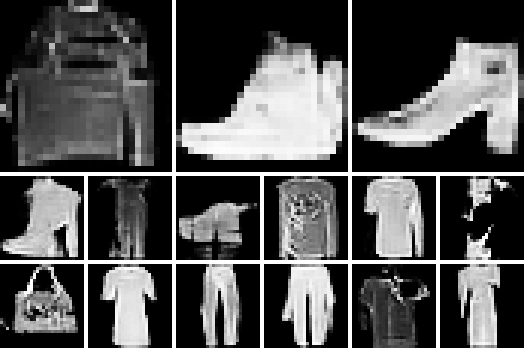
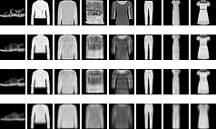
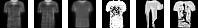
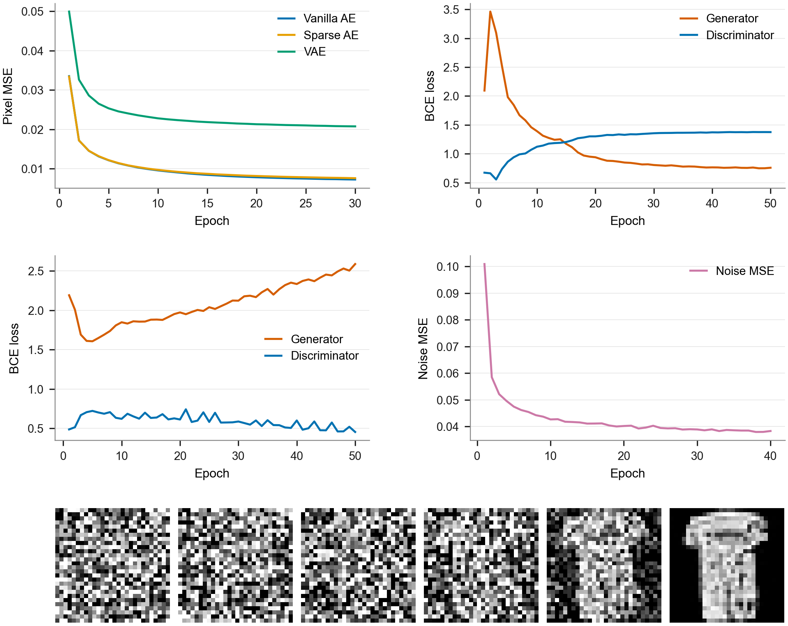

# Generative Modelling Throughout The Years: From Reconstruction to Iterative Denoising

This project follows generative modelling from reconstruction to iterative denoising. A vanilla autoencoder, a sparse autoencoder, a VAE, a fully connected GAN, a DCGAN, and a DDPM are trained on the same Fashion-MNIST split, with the seed and the evaluation held fixed, so the comparison is about the objective and the architecture. An MLP classifier with the same hidden width is included to test whether a latent code that classifies well can also generate an image.

DCGAN is the best model that draws new images. Its FID on 5,000 samples is **26.16**.



## Models

| Model | What it learns |
|---|---|
| Vanilla autoencoder | Reconstruct the image through a 64-d latent |
| Sparse autoencoder | Same network, plus an L1 penalty on the latent |
| VAE | Reconstruction plus a KL term, then sample from the prior |
| Vanilla GAN | A 100-d MLP generator and discriminator |
| DCGAN | The same game with a convolutional generator |
| DDPM | 1,000-step noise prediction with a small U-Net |
| MLP classifier | 784 → 256 → 64 → 10, then a decoder on frozen features |

Autoencoders are scored by reconstruction. GAN, DCGAN, and DDPM have no paired reconstruction, so MSE, PSNR, and SSIM are left blank. The plain autoencoders are not trained to sample a prior, so they have no FID. The VAE has both.

## Results

| Model | s / epoch | Latency (ms) | MSE | PSNR | SSIM | FID |
|---|---:|---:|---:|---:|---:|---:|
| Vanilla AE | 7.46 | 0.33 | 0.00739 | 22.36 | 0.808 | |
| Sparse AE | 7.41 | 0.24 | 0.00781 | 22.11 | 0.798 | |
| VAE | 7.51 | 0.14 | 0.01691 | 18.42 | 0.645 | 101.04 |
| Vanilla GAN | 9.42 | 0.33 | | | | 148.12 |
| DCGAN | 12.77 | 0.80 | | | | 26.16 |
| DDPM | 36.35 | 9325.39 | | | | 40.49 |

The classifier reaches **89.1%** test accuracy. Transposing its weight matrices does not reconstruct the image (MSE 0.285). A decoder trained on its frozen 64-d features does better (MSE 0.018) and still does not produce a clean garment when the latent is sampled.

The same eight test images, reconstructed by the vanilla autoencoder, the sparse autoencoder, and the VAE:



Class 0 across the six models. The autoencoders reconstruct the first test image of that class. The generators contribute the saved sample the classifier assigns to class 0 with the highest confidence.



Training curves, and one DDPM reverse chain with no step labels:



## Layout

```
src/            shared data split, models, metrics
notebooks/      one notebook per model, then the figure notebooks
results/artifacts/   checkpoints, histories, metrics, figures
```

| Notebook | Role |
|---|---|
| `01_mlp_classifier.ipynb` | Classifier and the latent-generation stages |
| `02_vanilla_ae.ipynb` | Vanilla autoencoder |
| `03_sparse_ae.ipynb` | Sparse autoencoder |
| `04_vae.ipynb` | VAE |
| `05_vanilla_gan.ipynb` | Vanilla GAN |
| `06_dcgan.ipynb` | DCGAN |
| `07_ddpm.ipynb` | DDPM |
| `08_figures_and_metrics.ipynb` | Assignment grids and `metrics.csv` |
| `09_publication_figures.ipynb` | Labeled figures in `figures_pub/` |
| `10_paper_figures.ipynb` | Text-free figures in `figures_paper/` |

Notebooks 01–07 were written for a Colab GPU runtime, with the project at `MyDrive/dl-sesi07`. `DRIVE_ROOT` in each setup cell is the place to change that path. PyTorch is expected to already be installed. The other dependencies are in `requirements.txt`.

`results/artifacts/fid_real.npy` is not in this folder. It is a cache of Inception features for the real images, and the FID code rebuilds it on the next run.
